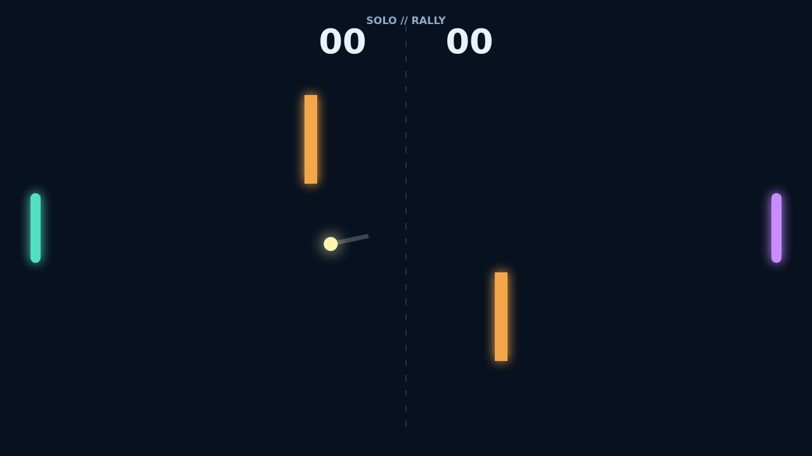

# Carom

Carom opens with a clean, tense rally: two paddles face each other across a
dark field while a bright ball threads between a pair of amber obstacles. Solo
matches put the right paddle in the hands of an alert opponent; Versus matches
let two local players share the keyboard.

Every hit is a choice. Meet the ball near the middle for a reliable return, or
reach for an edge angle and send it skimming toward a corner. Paddle movement
becomes spin at contact, bending the flight after the rebound and turning a
straight exchange into a changing line.

The obstacles make every rally a bank-shot puzzle. A ball can glance off one
bar, curve through the center, and arrive at the far paddle from an unexpected
height. Read the trail, set up the next angle, and keep your nerve through
deuce: the match only ends with an eleven-point score and a two-point lead.

